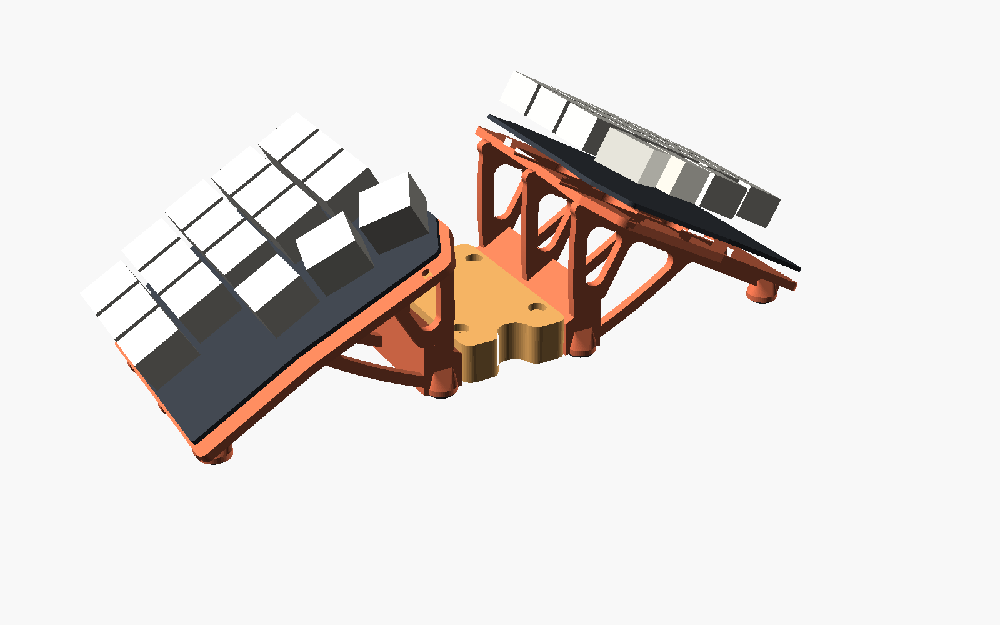
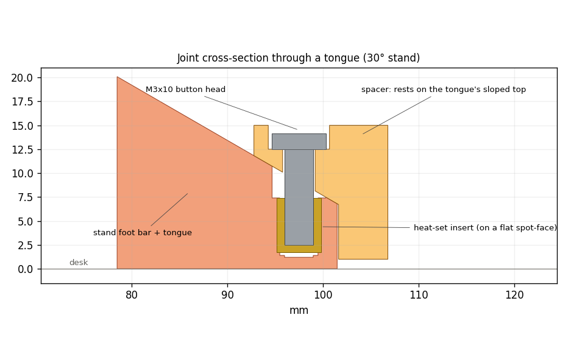

# Microdox tenting stand

A 3D-printed tenting stand for the Boardsource **Microdox v2** (wireless build). Each half gets one printed stand that replaces the stock 2.0 mm bottom plate. The keyboard screws onto it with its stock bottom screws, and the stand holds it at 20–35° of tent. A printed spacer locks the two halves together at whatever spacing and splay you choose, so they act as one board.



## Status
| Part | State |
|---|---|
| Stand (20/25/30/35°), spacers, coupler | Designed; all automated checks pass |
| Test prints (fit plate, joint test) | Ready. **Print these first.** |
| Metal base plate (heft) | Planned: a laser-cut steel or brass plate under each stand |
| Board geometry | From the v1 files; v2 match not yet confirmed (see "Before you print") |

## How it works
**Stand (one per half), printed as one piece:**
- **Plate:** this is what the keyboard screws onto. It has big soft openings, and stays solid around the screw holes and under the battery.
- **Ribs:** three curved ribs. They sit between the screw rows, so every bottom screw can be reached straight from below.
- **Foot bar:** a bar at desk level along the inner edge, carrying two dovetail tongues.
- **Feet:** a silicone strip under the foot bar and a silicone disc under each outer foot, in 0.5 mm recesses so the pads come out level.

**Joint between the halves.** A spacer drops onto the tongues of both stands.
- **Location:** each tongue is a dovetail, which stops the spacer moving sideways or front/back.
- **Height:** each tongue's top is a 30° slope, and the spacer's socket ceiling has the same slope. The spacer rests on that slope, so its height is set by geometry, not by how tight the print came out.
- **Clamp:** one M3×10 button-head screw per tongue goes down through the spacer's roof into a heat-set insert. Tightening pulls the spacer down the slope onto the dovetail, which takes out the play.
- **Interchangeable:** the joint is the same at every tent angle, so any spacer fits any pair of stands.
- **Spacing and splay:**
  - Spacing = `spacer_len`. For longer gaps, chain spacers with a coupler (A + 4 mm + B).
  - Splay is built into one spacer.



## Before you print
1. **Paper template** (`docs/fit_template_1to1_letter.pdf`): print at 100% / Actual size, then check the outline and all 5 holes against your board.
2. **Fit plate** (`stl/test-prints/fit_plate.stl`, about 1.5 h, 14 g): the stand's exact plate on its own. Screw the **left** half onto it with the stock screws. That proves the hole pattern, screw length, and battery/switch clearance.
3. **Joint test** (`joint_test_tongue.stl` + `joint_test_socket.stl`, about 30 min): fit a heat-set insert, drop the socket over the tongue, and drive an M3×10 screw. It should slide on by hand with no side play, and the screw should pull it snug.
4. **Measure:**
   - stock screw length and head size;
   - battery and switch depth below the bottom plate;
   - USB plug length.

## Printing
- **Material:** PLA or PLA+. It's stiffer than PETG and prints the slopes, bridges and dovetails more accurately. Use PETG or ASA only if the board will sit somewhere hot, like a parked car.
- **Orientation:** every STL is already exported in print orientation; **don't rotate them**.
  - The stand prints keyboard-face down on the bed.
  - The spacer prints roof down.
  - The coupler prints flat.
- **Supports:** **off**. The design is shaped so nothing needs them, and the checker proves it.
- **Settings:** 0.2 mm layers, 3 walls, 15% infill. A stand is about 36 g and 4 h at 30° (PrusaSlicer 2.7 estimate).

| File | Qty |
|---|---|
| `stl/stands/stand_left_XXdeg.stl`, `stand_right_XXdeg.stl` | 1 each, same angle |
| `stl/joint/spacer_40mm.stl` (or 60 / 80 / 45 mm with 10° splay) | 1 |
| `stl/joint/coupler.stl` | only to chain two spacers |
| `stl/test-prints/*` | first, once |

## Hardware
- Stock M2 bottom screws (the screw seats are 2.0 mm, the same as the stock plate)
- M3 heat-set inserts, Ø4.0 mm hole × 5.7 mm long: 2 per stand, 4 per coupler
- M3×10 button-head screws: 4 per spacer
- Self-adhesive silicone sheet, 1–1.5 mm thick: per stand, one 10 × 62 mm strip and two 8–9 mm discs
- Right-angle USB-C cable, for charging while the board is on the stand

## Assembly
1. **Inserts:** iron the heat-set inserts into each stand's two tongues. Go straight down, flush with the small flat around each hole. About 200 °C for PLA.
2. **Keyboard onto stand:** screw each half on with the stock M2 screws, from underneath through the open frame. Use a driver with a shaft ≥ 50 mm and a handle ≤ 12 mm across.
3. **Pads:** stick on the strip and discs. Use the same material on every foot so the stand sits level.
4. **Join:** set both halves on the desk, drop the spacer onto the four tongues, and snug the four M3×10 screws.

## Changing the design
Everything is one parametric OpenSCAD file, `cad/microdox_ribs.scad`. The board geometry is in `cad/microdox_ref.scad`. Change the numbers at the top of the file, then export:

```
openscad -D 'part="stand_left"'  -D tent_deg=27 -o stand_left.stl  cad/microdox_ribs.scad
openscad -D 'part="stand_right"' -D tent_deg=27 -o stand_right.stl cad/microdox_ribs.scad
openscad -D 'part="spacer"' -D spacer_len=55 -D splay_deg=8 -o spacer.stl cad/microdox_ribs.scad
```

**Limits:**
- tent 20–35°;
- `outer_lift` ≥ 8 mm;
- minimum `spacer_len` is 26 mm at 0° splay, 31 mm at 10°, 33 mm at 15°.

The file refuses values outside these.

## Checking a change
`tools/check_ribs.py` rebuilds the parts and checks them. It needs openscad and `pip install trimesh numpy shapely rtree`. It reads every constant from the .scad, so it follows any edit.

```
python3 tools/check_ribs.py --tent 20 25 30 35 --chain 40 60
```

**Stand:**
- one watertight piece, with nothing above the keyboard's plane;
- screw seats exactly 2.0 mm;
- a clear straight path to every bottom screw;
- USB plug clearance;
- fits a 220 mm bed;
- pad recesses all the same depth.

**Print:**
- in print orientation, nothing starts in mid-air (layer-by-layer check);
- no overhang bigger than a short bridge.

**Joint:**
- zero overlap at rest, and contact when the spacer is lowered 0.1 mm, which proves the slope sets the height;
- screws line up through the spacer roof into the inserts;
- M3×10 thread engagement;
- a straight tool path to every joint screw.

**Assembly:** no 3D collisions between both stands, the spacer and both keyboards, with splay applied. Chains are checked the same way.

`tools/stability.py --half-g <your half's weight in g>` estimates how hard you'd have to push a key to rock a lone half, and how much sideways drag slides the pair. Results are in `docs/check_results/`.

## Known limits
- **Lone half:** at 30–35° a single half on its own rocks under about 3.5–5.5 N on the worst thumb key. Joined by the spacer, the pair needs more than 50 N. Use the halves joined.
- **Grip:** a keypress can't slide the board if the pads' friction coefficient exceeds tan(tent), which is 0.58 at 30°. Silicone pads pass; bare plastic doesn't. To test: put a half on a scrap of your desk mat and tilt it. If it doesn't slide before the tilt passes your tent angle, typing won't walk it.
- **USB:** with a straight USB-C plug, `outer_lift` needs to be ≥ 11 mm at 30° (≥ 13 mm at 35°). A right-angle plug is fine at the default 8 mm.

## Repo layout
```
cad/            microdox_ribs.scad (the design), microdox_ref.scad/.json (board geometry)
stl/stands/     stands at 20/25/30/35 deg, left and right
stl/joint/      spacers and coupler
stl/test-prints fit plate, joint test pieces
tools/          check_ribs.py (checker), stability.py (rocking / sliding estimates)
docs/           fit template, images, checker logs
reference/      original source files (Boardsource, 40-percent) with their licenses
```

## Sources and licenses
- [boardsource/microdox-goodies](https://github.com/boardsource/microdox-goodies) (GPL-3.0): PCB outline and drill map. The stand's plate and hole pattern are derived from these, so if you publish this repo, licence it GPL-3.0 too.
- [40-percent/microdox-case](https://github.com/40-percent/microdox-case) (MIT): stock bottom-plate reference
- [waffle87 v2 build guide](https://github.com/waffle87/microdox/blob/master/v2_guide.md)
